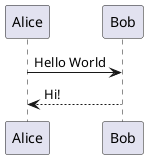

# language-grammar
Formal grammar definition for the PlantUML language, designed for syntax parsing, validation, and editor integration.

## Objectives
- Build upon the excellent work from [vscode-plantuml](https://github.com/qjebbs/vscode-plantuml).
- Become the official source for the PlantUML syntax used by [GitHub Linguist](https://github.com/github-linguist/linguist/blob/main/vendor/README.md).
- Enable the maintenance of syntax definitions for multiple tools and platforms, such as:
  - **Visual Studio Code**: Improved syntax highlighting and parsing extensions.
  - **GitHub Linguist**: For accurate language detection and rendering on GitHub.
  - **JetBrains IDEs**: Syntax support for IntelliJ IDEA, PyCharm, etc.
  - **TextMate/Atom**: Legacy syntax definitions for these editors.
  - **Tree-sitter**: For modern syntax parsing in tools like Neovim.
  - **Sublime Text**: Updated syntax highlighting packages.
  - **ACE Editor**: Syntax highlighting support for this lightweight, embeddable code editor.
  - **Online editors**: Such as GitPod or web-based IDEs.
  - **Language servers (LSP)**: Providing advanced features like autocompletion and diagnostics.

## Repository layout

| Path | Content |
| --- | --- |
| `syntaxes/` | The TextMate grammar (`source.wsd`) and the Markdown injection grammar (`codeblock.json`, scope `markdown.plantuml.codeblock`) used by GitHub Linguist, taken from [vscode-plantuml](https://github.com/qjebbs/vscode-plantuml) (MIT). |
| `tests/samples/` | PlantUML samples used to test the grammar. |
| `tests/scopes/` | For each sample, the TextMate scopes assigned to every token (regression snapshots). |
| `tests/render/` | For each sample, the highlighted result as SVG, in the GitHub light and dark themes. |
| `tools/` | Scripts that generate and check the files above. |
| `puml.ebnf` | Experimental reference grammar (Lark dialect), not used for highlighting. |

## Highlighting preview

**Gallery: <https://plantuml.github.io/language-grammar/>**. It is rebuilt by GitHub Actions on every push to `main` and shows all the samples of `tests/samples`, highlighted in the GitHub light and dark themes. Hovering a token shows its TextMate scopes. To build it locally, run `npm run site` in `tools/` and open `site/index.html`.

GitHub highlights code with TextMate grammars. To see the result of the grammar in this repository, the samples are rendered with [Shiki](https://shiki.style), which uses the same TextMate engine and the GitHub themes. The result is very close to what GitHub displays, but it is not guaranteed to be pixel-identical.

### `sequence-hello-world.puml`



<picture>
  <source media="(prefers-color-scheme: dark)" srcset="tests/render/sequence-hello-world.dark.svg">
  
</picture>

### `markdown-plantuml-fence.md`

A `plantuml` fenced block inside a Markdown file, highlighted through the injection grammar.

<picture>
  <source media="(prefers-color-scheme: dark)" srcset="tests/render/markdown-plantuml-fence.dark.svg">
  
</picture>

Whether GitHub itself uses the injection grammar for Markdown is not known: the Markdown renderer may resolve the `plantuml` fence directly to the language through Linguist. The injection grammar is kept because the current Linguist entry for this grammar lists both scopes.

## Running the tests

Requires Node.js 22 or later.

```
cd tools
npm ci
npm run build   # regenerate tests/scopes and tests/render
npm test        # fail if the generated files are out of date
```

To add a test, drop a `.puml` file in `tests/samples/`, run `npm run build`, review the generated scopes and SVG files, and commit them together with the sample. The same check runs on every push through GitHub Actions.

## License
This project is licensed under the [MIT License](LICENSE).

The TextMate grammar in `syntaxes/` derives from [vscode-plantuml](https://github.com/qjebbs/vscode-plantuml), Copyright (c) 2016 jebbs, also under the MIT License (see `syntaxes/LICENSE.vscode-plantuml.txt`).
