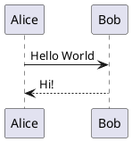
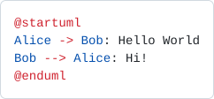
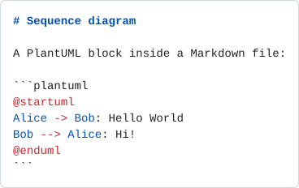

# language-grammar

Syntax definitions for the PlantUML language, designed for syntax highlighting, parsing, validation, and editor integration.

[](https://plantuml.github.io/language-grammar/)

[](https://github.com/plantuml/language-grammar/actions/workflows/test.yml)
[](https://github.com/plantuml/language-grammar/actions/workflows/pages.yml)
[](LICENSE)

**See how PlantUML code is highlighted, live: <https://plantuml.github.io/language-grammar/>**

**Try your own code: <https://plantuml.github.io/language-grammar/playground/index.html>** (a textarea highlighted live in the browser, with the current grammar or the hybrid prototype).

## What we are trying to do

When a `.puml` file is displayed on GitHub, its colors come from a **TextMate grammar** declared in [GitHub Linguist](https://github.com/github-linguist/linguist). Today, Linguist takes this grammar from a third-party project, [vscode-plantuml](https://github.com/qjebbs/vscode-plantuml), at a fixed commit (see the [vendor README](https://github.com/github-linguist/linguist/blob/main/vendor/README.md)).

The goal of this repository is to **become the official source of the PlantUML syntax used by GitHub Linguist**, by starting from the excellent work of vscode-plantuml and improving it step by step, with tests that show what the result looks like.

In the longer term, the same repository could maintain the syntax definitions for other tools and platforms:

- **Visual Studio Code**: improved syntax highlighting and parsing extensions.
- **JetBrains IDEs**: syntax support for IntelliJ IDEA, PyCharm, etc.
- **TextMate/Atom**: legacy syntax definitions for these editors.
- **Tree-sitter**: modern syntax parsing in tools like Neovim.
- **Sublime Text**: updated syntax highlighting packages.
- **ACE Editor**: syntax highlighting for this lightweight, embeddable code editor.
- **Online editors**: such as GitPod or web-based IDEs.
- **Language servers (LSP)**: advanced features like autocompletion and diagnostics.

## Where we are

`syntaxes/plantuml.yaml-tmLanguage` is, for now, an unmodified copy of the grammar used by GitHub Linguist today (vscode-plantuml at commit `7bc1758`). What has been built first is the **test and preview infrastructure**, so that every future change to the grammar can be seen and checked:

- a set of hand-picked samples in `tests/samples/`, one per family of diagrams (sequence, class, activity, Gantt, mind map, salt, JSON, YAML, `<style>`, preprocessor, and a Markdown fence);
- a snapshot of the TextMate scopes of every token;
- a rendering of every sample in the GitHub light and dark themes;
- a public gallery and a live playground, rebuilt on every push to `main`;
- a **hybrid grammar prototype** (see below), tested and shown next to the current one.

## Technical choices

### The deliverable is a TextMate grammar

GitHub Linguist highlights code with TextMate grammars, so this is what must be produced first. The scope name stays `source.wsd`, as in the current grammar. The starting point is the vscode-plantuml grammar (MIT license, credited below), which already covers many diagram types with line-oriented regular expressions.

### Small steps

We work one diagram, one sample at a time: add a sample, look at how it is highlighted, improve the grammar, check that nothing else changed.

### We cannot test on GitHub itself

GitHub colors the files of a repository with the grammar declared in Linguist, not with the one of the repository being viewed. A new grammar is therefore not visible on GitHub before it is accepted into Linguist. To see its effect earlier, we reproduce what GitHub does:

- **[Shiki](https://shiki.style)** loads a TextMate grammar with the same regular expression engine (Oniguruma) as TextMate, and applies the GitHub themes (`github-light-default`, `github-dark-default`).
- The result is very close to what GitHub displays, but **it is not guaranteed to be identical**: GitHub uses its own renderer. The final check can only be done once the grammar is in Linguist.

Rouge, a Ruby highlighter, was considered and dropped: its lexers are written in Ruby and it cannot load TextMate grammars, so it would not test what GitHub uses.

### Three kinds of checks

For each sample in `tests/samples/`:

1. **Scope snapshot** (`tests/scopes/`): the TextMate scopes given to every token. A change in the grammar that modifies the scopes of any sample is detected. This is done for both grammars.
2. **SVG rendering** (`tests/render/`): the highlighted code in the GitHub light and dark themes, displayed directly by GitHub in this repository.
3. **Gallery** (GitHub Pages): all the samples on one page, with a theme switch and the scopes shown when hovering a token.

A GitHub Action fails if the committed files differ from what the grammar produces.

### The Markdown injection grammar

A TextMate grammar describes one language. To color a PlantUML block inside a Markdown file, the Markdown grammar must be told to use it. An *injection grammar* does this: it plugs another grammar into a given zone of a host grammar. `syntaxes/codeblock.json` (scope `markdown.plantuml.codeblock`) says "inside a code block whose language is `plantuml`, apply the PlantUML grammar".

It is kept because the current Linguist entry lists both scopes, and it is tested with a Markdown sample. Whether GitHub itself uses it, or resolves the `plantuml` fence directly to the language through Linguist, is not known.

### The hybrid grammar (prototype)

`syntaxes/plantuml-hybrid.tmLanguage.json` is a second grammar, **generated** by `tools/generate-grammar.mjs`. It does not replace the current one yet: both are tested on the same samples and shown side by side in the gallery (the *Grammar* link at the top of each page switches from one to the other).

- **The words come from PlantUML itself.** The types, keywords, directives, skin parameters and colors are read from `data/list-keywords.txt`, so a new word of PlantUML only needs a new export of that file. Only the known skin parameter names are colored, not any word.
- **The grammar starts with the `@startXXX` line**, because the language that follows depends on it. `@startjson` and `@startyaml` are handed to the JSON and YAML grammars, `@startmindmap`/`@startwbs`, `@startgantt`, `@startsalt` and `@startnwdiag`/`@startpacketdiag` have their own rules, and `@startuml` (and any other `@startxxx`) gets the general rules. A `<style>` block is handed to the CSS grammar.
- **One scope per type of word**, so that a theme can give them different colors: `storage.type.element.wsd` for `class`/`actor`/`participant`, `keyword.control.wsd` for `alt`/`note`/`skinparam`, `entity.name.function.preprocessor.wsd` for `!include`, `variable.parameter.skinparam.wsd` for skin parameters, `constant.other.color.wsd` for colors, and so on. The GitHub themes only have a handful of colors, so some types share one: types and keywords are both red, for example.
- **Element names are colored where they are used, not only where they are declared.** The names on both sides of an arrow (`Alice -> Bob`, `Map <|.. HashMap`) get `entity.name.type.wsd` (orange), like the name of a declaration. Type parameters (`Map<K,V>`) and the content of a qualifier (`Shop [customerId: long] --> Customer`) get `support.type.wsd` and `support.type.property-name.wsd` (blue). A direction written with one letter (`-r->`) is part of the arrow.
- **The text of messages, notes, titles and legends is not code**: it is not colored as keywords. A block that is never closed stops at the end of the diagram.

Limits of the prototype:

- `data/list-keywords.txt` is a flat list: it does not say which words belong to which diagram. The words that are only valid inside a statement (such as `left` in `note left of A`) are listed by hand in the generator (`INLINE_ONLY`), and the rules of each family (mind map, Gantt, salt, ...) are written by hand. A list of the words of each diagram would need to come from PlantUML itself.
- `@startuml` contains many kinds of diagrams (sequence, class, activity, state, ...) that PlantUML recognizes from the content: the general rules are a union of them.
- `@startdot` and `@startditaa` are not colored yet (the DOT grammar is not available in the test tool).

### `puml.ebnf` is an experiment

`puml.ebnf` is a formal grammar in the Lark dialect (an extended EBNF that can be run, which makes it easy to try). It is **not used for highlighting** and it only covers a subset of the language (component diagrams). The syntax of PlantUML is line-oriented and depends on the diagram type, and its actual definition is in regular expressions in the Java code of PlantUML, so a complete formal grammar is hard to write. It stays a reference experiment and does not block the work on Linguist.

### Out of scope for now

- Snippets and the preview templates of vscode-plantuml (specific to VS Code).
- The other targets listed above (tree-sitter, JetBrains, LSP, ...).

## Repository layout

| Path | Content |
| --- | --- |
| `syntaxes/` | The TextMate grammar (`source.wsd`) and the Markdown injection grammar (`codeblock.json`), taken from [vscode-plantuml](https://github.com/qjebbs/vscode-plantuml) (MIT), and the generated hybrid prototype (`plantuml-hybrid.tmLanguage.json`). |
| `tests/samples/` | Hand-picked PlantUML samples used to test the grammar, with an optional `<name>.description.txt` explaining what each one tests. Each one has a scope snapshot and SVG renders. |
| `tests/vega/` | The Vega corpus: the non-regression tests of PlantUML, copied from the PlantUML repository (514 `.puml` files in folders). Shown in the gallery, without snapshots for now. The YAML header that most files have before `@startuml` is a test setting, not PlantUML code: it is ignored. |
| `tests/scopes/` | For each sample, the TextMate scopes of every token (snapshots). `<name>.txt` for the current grammar, `<name>.hybrid.txt` for the prototype. |
| `tests/render/` | For each sample, the highlighted result as SVG, in the GitHub light and dark themes (`<name>.hybrid.*.svg` for the prototype). |
| `data/` | Reference data from PlantUML itself: `list-keywords.txt`, the output of `plantuml.jar --list-keywords` (see `data/README.md`). |
| `tools/` | Node.js scripts that generate and check the files above and build the gallery. |
| `.github/workflows/` | `test.yml` (checks) and `pages.yml` (gallery). |
| `puml.ebnf` | Experimental reference grammar (Lark dialect), not used for highlighting. |

## Which files really configure the highlighting

Three files define how PlantUML code is colored. `tools/common.mjs` loads them (`grammarFile`, `hybridFile` and `injectionFile`) and passes them to Shiki. The two grammars are never used together: each test and each gallery page uses one or the other.

**Files that are used for highlighting**

| File | Role |
| --- | --- |
| `syntaxes/plantuml.yaml-tmLanguage` | The current TextMate grammar (scope `source.wsd`), the one of GitHub Linguist today. |
| `syntaxes/plantuml-hybrid.tmLanguage.json` | The hybrid prototype (same scope `source.wsd`). It is generated by `tools/generate-grammar.mjs` from `data/list-keywords.txt`: do not edit it by hand. |
| `syntaxes/codeblock.json` | The injection grammar (scope `markdown.plantuml.codeblock`): it applies `source.wsd` inside the `plantuml` fenced blocks of Markdown files. |

The colors themselves do not come from a file of this repository: they come from the Shiki themes `github-light-default` and `github-dark-default`, set in `tools/common.mjs` (see [GitHub highlighting colors](#github-highlighting-colors)).

**Files that are not used for highlighting**

| File | Why it is not used |
| --- | --- |
| `puml.ebnf` | Experimental formal grammar (Lark dialect), covering only a subset of the language. |
| `data/list-keywords.txt` | Not read while highlighting. It is the input of `tools/generate-grammar.mjs` (which builds the hybrid grammar) and of `tools/coverage.mjs` (an informational report that never fails the build). |
| `syntaxes/LICENSE.vscode-plantuml.txt` | License text of vscode-plantuml. |

**Files that are generated**

`syntaxes/plantuml-hybrid.tmLanguage.json`, `tests/scopes/` and `tests/render/` are produced by `npm run build` (`tools/generate-grammar.mjs` then `tools/render.mjs`), and `npm test` fails if they no longer match what the generators produce. The gallery is built by `tools/site.mjs` from the `tests/` tree. The two workflows (`test.yml` and `pages.yml`) only run these scripts.

## GitHub highlighting colors

A TextMate grammar only gives a **scope** to each token. The color is chosen by the theme, and the GitHub themes have a very small palette. These are the colors of `github-light-default` and `github-dark-default`, as shipped in the Shiki version pinned in `tools/package-lock.json` (4.5.0). The scopes are those of the themes: a token is colored by the most specific scope that matches.

| Color role | Light | Dark | Scopes in the theme |
| --- | --- | --- | --- |
| Comment (gray) | `#6e7781` | `#8b949e` | `comment`, `punctuation.definition.comment`, `string.comment` |
| Red | `#cf222e` | `#ff7b72` | `keyword`, `storage`, `storage.type`, `constant.character`, `constant.other.placeholder`, `punctuation.section.embedded` |
| Blue | `#0550ae` | `#79c0ff` | `constant`, `entity`, `support`, `variable.language`, `variable.other.constant`, `meta.property-name`, `meta.module-reference` |
| Orange | `#953800` | `#ffa657` | `variable`, `entity.name`, `meta.definition.variable`, `meta.export.default` |
| Purple | `#8250df` | `#d2a8ff` | `entity.name.function` |
| Green | `#116329` | `#7ee787` | `entity.name.tag`, `support.class.component`, `support.type.property-name.json` |
| Dark blue (strings) | `#0a3069` | `#a5d6ff` | `string`, `string.regexp`, `source.regexp` |
| Invalid (dark red, italic) | `#82071e` | `#ffa198` | `invalid.*`, `message.error`, `brackethighlighter.unmatched` |
| Default text | `#1f2328` | `#e6edf3` | `meta.block`, `meta.object.member`, `variable.other`, `variable.parameter.function`, `storage.type.java`, `storage.modifier.package`, `storage.modifier.import` |

Notes:

- There is only one color per role, so two scopes of the same family cannot get different colors: types (`storage.type`) and keywords (`keyword`) are both red.
- Some more specific scopes go back to the default text color, for example `variable.other` and `storage.type.java`. A scope that looks like a variable is not always orange.
- The themes also color a few Markdown and diff scopes (headings, quotes, inserted and deleted lines) with the same palette.
- Bold and italic are used very little: bold for Markdown headings and bold text, italic for `invalid.*` and Markdown italic.
- The background is `#ffffff` in the light theme and `#0d1117` in the dark theme.
- Shiki reproduces the GitHub themes, but GitHub uses its own renderer: the final colors are only certain once a grammar is in Linguist.

## Highlighting preview

The [gallery](https://plantuml.github.io/language-grammar/) follows the tree of the `tests/` folder: `tests/samples/...` is published as `samples/...` and `tests/vega/...` as `vega/...`, with one page per folder, a theme switch, and the TextMate scopes of every token on hover. Here are two of the hand-picked samples as pictures:

### `sequence-hello-world.puml`



<picture>
  <source media="(prefers-color-scheme: dark)" srcset="tests/render/sequence-hello-world.dark.svg">
  
</picture>

### `markdown-plantuml-fence.md`

The same diagram inside a `plantuml` block of a Markdown file, which tests the injection grammar.

<picture>
  <source media="(prefers-color-scheme: dark)" srcset="tests/render/markdown-plantuml-fence.dark.svg">
  
</picture>

## Highlighting of other languages on GitHub

The blocks below are not PlantUML. They are rendered by GitHub with the grammars it uses for these languages, with the same themes as above. They are here to see, in the page you are reading, which color GitHub gives to comments, keywords, strings, numbers, function names, class names, constants and so on, in your current theme (switch between light and dark in your GitHub settings to compare).

### Python

```python
import re
from dataclasses import dataclass

MAX_ITEMS = 3  # a constant


@dataclass
class Participant:
    name: str
    active: bool = True

    def greet(self, other: "Participant") -> str:
        """Return a greeting."""
        return f"{self.name} -> {other.name}: Hello World"


def parse(line: str) -> list[str]:
    pattern = re.compile(r"^(\w+)\s*->\s*(\w+)")
    match = pattern.match(line)
    if match is None:
        raise ValueError("not an arrow: %r" % line)
    return [g for g in match.groups() if g][:MAX_ITEMS]


if __name__ == "__main__":
    alice, bob = Participant("Alice"), Participant("Bob")
    print(alice.greet(bob), parse("Alice -> Bob"), 42, 3.14, None, True)
```

### Java

```java
package org.example.grammar;

import java.util.ArrayList;
import java.util.List;

/** A participant of a sequence diagram. */
public class Participant implements Comparable<Participant> {

    private static final int MAX_ITEMS = 3; // a constant

    private final String name;
    private boolean active = true;

    public Participant(String name) {
        this.name = name;
    }

    @Override
    public int compareTo(Participant other) {
        return name.compareTo(other.name);
    }

    public String greet(Participant other) {
        return name + " -> " + other.name + ": Hello World";
    }

    public static List<String> parse(String line) {
        List<String> result = new ArrayList<>();
        for (String part : line.split("->")) {
            if (!part.isBlank() && result.size() < MAX_ITEMS) {
                result.add(part.trim());
            }
        }
        return result;
    }

    public static void main(String[] args) {
        Participant alice = new Participant("Alice");
        System.out.println(alice.greet(new Participant("Bob")) + 42 + 3.14 + null + true);
    }
}
```

### JavaScript

```javascript
import { readFileSync } from "node:fs";

const MAX_ITEMS = 3; // a constant

class Participant {
  #active = true;

  constructor(name) {
    this.name = name;
  }

  greet(other) {
    return `${this.name} -> ${other.name}: Hello World`;
  }
}

/**
 * Split an arrow line into its participants.
 * @param {string} line
 * @returns {string[]}
 */
function parse(line) {
  const match = /^(\w+)\s*->\s*(\w+)/.exec(line);
  if (!match) throw new Error(`not an arrow: ${line}`);
  return match.slice(1, 1 + MAX_ITEMS);
}

const alice = new Participant("Alice");
const lines = readFileSync("diagram.puml", "utf8").split("\n");
console.log(alice.greet(new Participant("Bob")), lines.map(parse), 42, 3.14, null, true);
```

## Working on the grammar

Requires Node.js 22 or later.

```
cd tools
npm ci
npm run build   # regenerate the hybrid grammar, tests/scopes and tests/render
npm test        # fail if the generated files are out of date
npm run site    # build the gallery in site/ (open site/index.html)
npm run coverage  # how many words of data/list-keywords.txt the grammar recognizes
npm run coverage -- --grammar=hybrid   # the same for the hybrid prototype
npm run grammar   # regenerate only the hybrid grammar
```

To add a test:

1. Put a `.puml` (or `.iuml`, `.plantuml`, `.md`) file in `tests/samples/`, and optionally a `<name>.description.txt` next to it.
2. Run `npm run build` and review the generated scopes and SVG files (for both grammars).
3. Commit them together with the sample.

## Continuous integration

- **Test** runs on every push and pull request. It fails if the hybrid grammar, `tests/scopes` or `tests/render` are out of date, and uploads the regenerated files as an artifact to help fixing it.
- The Test job summary also shows the **keyword coverage** of the grammar (information only, it never fails the build); the gallery home page shows it too.
- **Pages** runs on every push to `main`. It runs the same check, builds the gallery and publishes it with GitHub Pages. It requires *Settings > Pages > Build and deployment > Source* to be set to *GitHub Actions*.

## License

This project is licensed under the [MIT License](LICENSE).

The TextMate grammar in `syntaxes/` derives from [vscode-plantuml](https://github.com/qjebbs/vscode-plantuml), Copyright (c) 2016 jebbs, also under the MIT License (see `syntaxes/LICENSE.vscode-plantuml.txt`).
